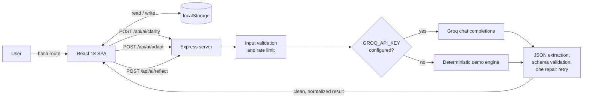
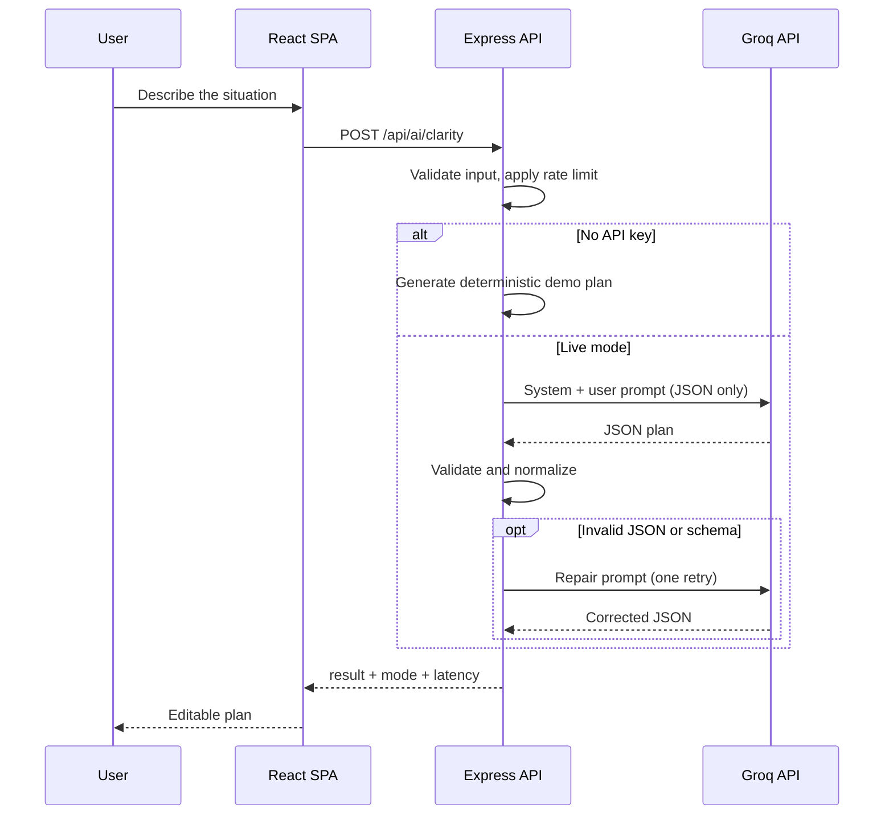

# HumanLoop

**Turn life's chaos into your next clear action.**

HumanLoop is a focused web app for the moment when everything feels equally urgent. You describe the mess in plain language; it reflects back what it heard, turns the situation into a short, realistic plan, and then stays with you while you work: a focus timer, an editable task list, adaptive replanning when the day changes, and an end-of-day reflection that carries one clear action into tomorrow.

Built for the hackathon with **React + Vite**, **Express**, and **Groq**. Runs fully in a clearly labelled demo mode without an API key.

---

## The problem

When you are overwhelmed, the bottleneck is rarely effort. It is **deciding what to do next**. Generic to-do lists capture everything and prioritise nothing; chat assistants give advice you cannot act on; productivity apps ask you to maintain a system while you are already behind. The result is more open loops, more avoidance, and another day that ends with the same list.

## The solution

HumanLoop is built around a single loop:

1. **Say what is going on.** One free-text box, no forms.
2. **See it reflected.** The Clarity Engine names the real bottleneck and returns a small plan with durations, priorities, and a concrete "done when".
3. **Do the next block.** Tasks can be edited before they are added. The focus timer records only time that actually passes.
4. **Replan without guilt.** A check-in ("I have less time", "I'm exhausted", "Something changed") produces specific, reviewable adjustments you apply one at a time.
5. **Close the loop.** A short reflection saves what moved, what stalled, and the one action for tomorrow.

Everything is local-first. The app works without an account, and the server never stores your data.

## What you can do

- **Clarity Engine** — describe a messy situation and get a validated plan: headline, honest read of the situation, likely blockers, and 3–6 tasks with estimates, priorities, deadlines, and done criteria.
- **Editable plans** — edit any generated task before adding it; duplicates are skipped rather than silently multiplied.
- **Task workspace** — create, edit, complete, reopen, and delete tasks; filter by status/priority; search; sort; see overdue and high-priority counts.
- **Focus Mode** — a real countdown timer with start, pause, resume, end-and-log, session presets, and a live indicator. Time is only logged when it actually elapses.
- **Adaptive replanning** — check in with a signal and a note; review each proposed change (reschedule, reduce scope, split, defer, drop, complete, add) and apply it deliberately.
- **Reflection** — a guided end-of-day form returns a written reflection, wins, and next steps; history is saved locally.
- **Overview dashboard** — today's plan, next best action, momentum stats, a seven-day focus chart, and recent activity, all derived from real state.
- **Settings** — theme (Charcoal / Paper), AI connection test, export/import of your workspace as JSON, and a full reset.
- **Demo mode** — with no API key the app still works end to end using deterministic samples generated from your own words. The UI and API both say clearly that it is demo mode, not live AI.
- **Responsive, dark-first UI** — editorial typography, charcoal surfaces, a lime accent, keyboard-accessible dialogs, reduced-motion support, and layouts verified at 1440 px and 390 px.

## Screenshots

Place these images in `docs/screenshots/` before publishing the Devpost entry:

| File | What to capture |
| --- | --- |
| `docs/screenshots/overview.png` | Overview with today's tasks and the demo-mode banner visible |
| `docs/screenshots/clarity.png` | A generated plan with tasks, estimates, and "done when" |
| `docs/screenshots/focus.png` | Focus Mode with a running timer |
| `docs/screenshots/reflection.png` | A completed reflection with wins and next steps |

Suggested capture size: 1440 × 1000, dark theme, browser zoom at 100%. Do not fabricate UI state; use the real demo flow.

## Architecture



A clarity request, end to end:



### Design decisions

- **No database.** Task, plan, reflection, and profile data live in `localStorage` under `humanloop.state.v1`. The server is stateless apart from an in-memory rate-limit bucket.
- **One package, two processes in development.** Vite serves the UI on `:5173` and proxies `/api` to Express on `:3000`. In production, Express serves `dist/` and the API from one port.
- **No router dependency.** A small hash router makes static hosting and reloads predictable.
- **No UI framework.** A hand-written CSS system (`base`, `pages`, `workspace`, `responsive`) keeps the bundle small and the visual language consistent.

## Tech stack

| Layer | Choice |
| --- | --- |
| UI | React 18.3, hand-written CSS, inline SVG icon set |
| Build | Vite 6 |
| Server | Node.js ≥ 20, Express 4 |
| AI | Groq OpenAI-compatible chat completions, JSON-only prompts |
| Persistence | Browser `localStorage` (no server-side user data) |
| Tests | `node:test` unit tests, HTTP smoke test, headless Chrome UI check |

## Run it locally

### 1. Install

```bash
npm install
```

### 2. Add your Groq key

```bash
cp .env.example .env        # Windows PowerShell: Copy-Item .env.example .env
```

Open `.env` and set:

```dotenv
GROQ_API_KEY=gsk_your_key_here
GROQ_MODEL=openai/gpt-oss-120b
```

Get a key at <https://console.groq.com/keys>. The key is read **only** by the Express server from the environment; it is never sent to the browser, logged, or committed. `.env` is git-ignored.

If your Groq account does not have access to `openai/gpt-oss-120b`, set `GROQ_MODEL` to a chat model your account lists at <https://console.groq.com/docs/models>.

### 3. Start

```bash
npm run dev
```

Open <http://localhost:5173>. The API runs on <http://localhost:3000>.

For a production build:

```bash
npm run build
npm start
```

Open <http://localhost:3000>. Express serves the built app and the API together.

### Demo mode

Leave `GROQ_API_KEY` empty (or remove it) and start the app normally. Every AI surface still responds, using deterministic sample generators that are derived from your input and run on the server. The overview shows a demo banner, Settings reports "Demo mode", and each API response includes `"mode": "demo"` plus a notice. Demo output is never presented as live model output.

## Scripts

| Command | What it does |
| --- | --- |
| `npm run dev` | Express API + Vite dev server with hot reload |
| `npm run dev:server` | API only, with `node --watch` |
| `npm run dev:web` | Vite dev server only |
| `npm run build` | Production build into `dist/` |
| `npm start` | Serve `dist/` and the API from Express |
| `npm run preview` | Build, then start the production server |
| `npm test` | 25 unit tests for validation, demo generation, and helpers |
| `npm run smoke` | 9 HTTP checks against a running server (default port 3000) |
| `node scripts/ui-check.mjs` | 12 headless-Chrome checks against a running server (needs Chrome) |

`npm run smoke` and the browser check expect a server that is already running. The browser check uses your installed Chrome/Chromium and the DevTools protocol, with no extra npm packages; set `CHROME_PATH` if Chrome is not in a standard location.

## API

All endpoints accept and return JSON. Requests are capped at 64 KB and rate-limited to 30 requests per minute per IP per process. Errors use a consistent shape:

```json
{ "error": { "code": "invalid_request", "message": "Your description must be at least 8 characters." } }
```

| Method | Path | Purpose |
| --- | --- | --- |
| `GET` | `/api/health` | Mode, configured model, whether a key is present, uptime |
| `POST` | `/api/ai/clarity` | `{ situation, tasks?, history? }` → headline, understanding, blockers, tasks |
| `POST` | `/api/ai/adapt` | `{ signal, note?, tasks }` → headline, assessment, adjustments, nextAction |
| `POST` | `/api/ai/reflect` | `{ input: { accomplished, unfinished?, blockers?, nextPriority? }, stats?, tasks? }` → headline, reflection, wins, nextSteps |

Every successful response includes `mode` (`"live"` or `"demo"`), the model name, and `latencyMs`. In demo mode it also includes a human-readable `notice`.

### Reliability and edge cases

- Missing or placeholder keys fall back to demo mode instead of failing.
- Upstream calls have a configurable timeout (`AI_TIMEOUT_MS`, default 30 s) and a single retry for transient failures.
- Returned JSON is extracted safely, validated field by field, clamped to sensible lengths and ranges, and dates are normalized. If the model returns an unusable plan, the server makes one repair attempt, then returns a structured `502` rather than rendering broken state.
- Auth failures, unknown models, rate limits, timeouts, and network errors map to readable messages without exposing internals.
- Invalid client input returns `400` with a specific field message; unknown routes return JSON `404`.
- Security headers (`nosniff`, `DENY` framing, same-origin referrer, restricted permissions) are set on every response; API responses are `no-store`.

## Project structure

```text
humanloop/
├─ server/
│  ├─ index.js          Express app, routes, static serving, error handling
│  ├─ config.js         Environment parsing, key cleanup, runtime info
│  ├─ demo.js           Deterministic demo plan/adaptation/reflection
│  ├─ ai/
│  │  ├─ groq.js        Upstream client: timeout, retry, JSON extraction
│  │  ├─ prompts.js     JSON-only system and user prompts
│  │  ├─ validate.js    Schema validation, normalization, clamping
│  │  ├─ input.js       Request sanitizers and signals
│  │  ├─ dates.js       Relative-date normalization
│  │  └─ errors.js      Error taxonomy and public messages
│  └─ tests/            node:test unit tests
├─ src/
│  ├─ App.jsx           Hash routes, layout, mobile drawer
│  ├─ context/          State, timer, toasts, health, persistence
│  ├─ components/       UI primitives and product components
│  ├─ pages/            Overview, Clarity, Tasks, Focus, Reflection, Settings
│  ├─ lib/              API client, storage, stats, formatting
│  └─ styles/           Design tokens, pages, workspace, responsive rules
├─ scripts/             HTTP smoke test, headless browser check
├─ public/              Favicon and static assets
├─ Dockerfile
├─ render.yaml
└─ .env.example
```

## Data and privacy

- Your tasks, plans, and reflections are stored in your browser, not on the server.
- The server receives only what is needed for the current AI request and does not persist it.
- No analytics, cookies, accounts, or third-party scripts are included.
- **Clear workspace** in Settings removes all local data after confirmation. Export first if you want a copy.
- When live mode is enabled, the text you submit is sent to Groq under your account's terms; do not paste secrets into the prompt fields.

## Verification performed

- `npm test` — 25/25 unit tests pass (plan, adaptation, reflection validation; demo determinism; input/date helpers).
- `npm run smoke` — 9/9 checks pass against a running production server: health, HTML, JSON 404, all three AI routes, invalid input, malformed JSON, security headers.
- `node scripts/ui-check.mjs` — 12/12 checks pass in headless Chrome: render, plan generation, task create/complete/filter, replan apply, timer countdown/pause/end, reflection save, theme switch, connection test, reload persistence, mobile drawer, all routes at 390 px, and zero console/runtime errors.
- Live mode was exercised against Groq with a real key and `openai/gpt-oss-120b`; responses were validated end to end. Demo mode is the default when no key is present.
- `npm run build` completes with no errors (~61 kB CSS, ~259 kB JS before gzip).

## Known limitations

- **Local-first, single device.** There is no account system or cloud sync, so data does not follow you between browsers and is lost if site data is cleared. Export is the backup path.
- **Single-process rate limiting.** The limiter is in memory and resets on restart; it is not a distributed quota.
- **Demo mode is template-based.** It is deterministic and derived from your input, but it is not a language model. The UI labels it clearly.
- **Model availability varies by Groq account.** The default model can be changed with `GROQ_MODEL`; unavailable models return a readable error.
- **No streaming.** Responses arrive when complete, which keeps validation atomic.
- **Not an advisor.** Output is organisational support, not medical, legal, or financial advice.
- **Browser coverage.** Behaviour is verified in Chromium at desktop and mobile widths; Safari and Firefox have not been part of the automated matrix.
- **Storage caps.** The app keeps up to 500 tasks and 50 reflections locally; older entries are trimmed on load.

## Future work

- Optional accounts and encrypted sync, with a real database and per-user quotas.
- Calendar and email integrations so deadlines and open loops import themselves.
- Streaming responses with the same validation guarantees.
- Smarter history: use past reflections to detect recurring blockers and adjust plan defaults.
- Notifications and a PWA install path with offline support.
- Shared workspaces for small teams, with permissions.
- Accessibility and cross-browser audits, including automated visual regression tests.

## Deployment

### Render (Blueprint)

The repo includes `render.yaml`:

1. Push the project to GitHub.
2. In Render, choose **New → Blueprint** and select the repo.
3. Set `GROQ_API_KEY` when prompted (leave it blank for demo mode).
4. Deploy. Build: `npm ci && npm run build`; start: `npm start`; health check: `/api/health`.

Any Node host works the same way: install, build, then `npm start` with `GROQ_API_KEY` set as an environment variable.

### Docker

```bash
docker build -t humanloop .
docker run --rm -p 3000:3000 -e GROQ_API_KEY=gsk_your_key_here humanloop
```

Open <http://localhost:3000>. Omit `-e GROQ_API_KEY` to run in demo mode.

## Devpost

A concise submission description is in [DEVPOST.md](DEVPOST.md).

---

Built with care for people who are tired of managing their tools instead of their day.
